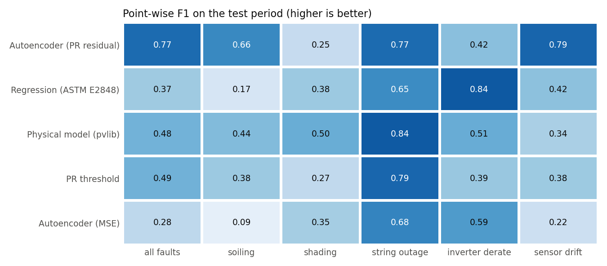
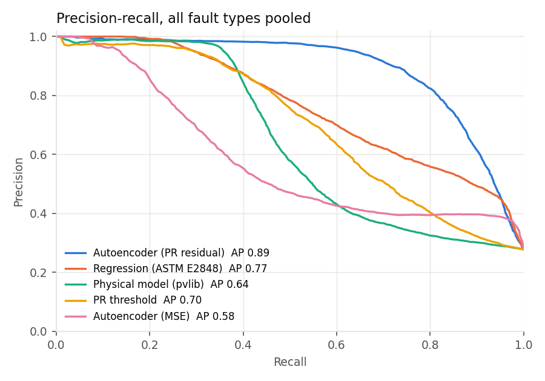
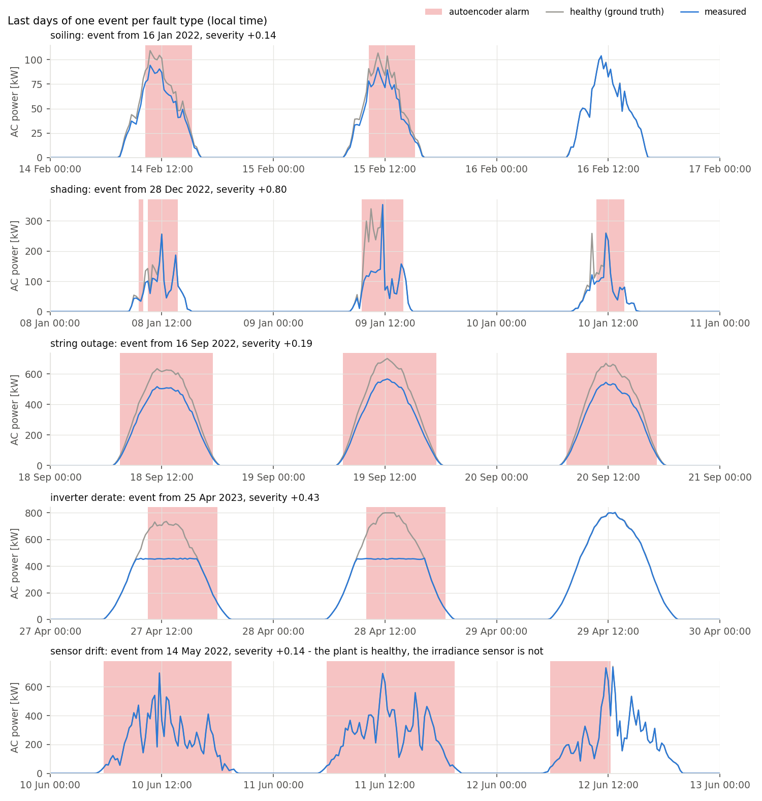
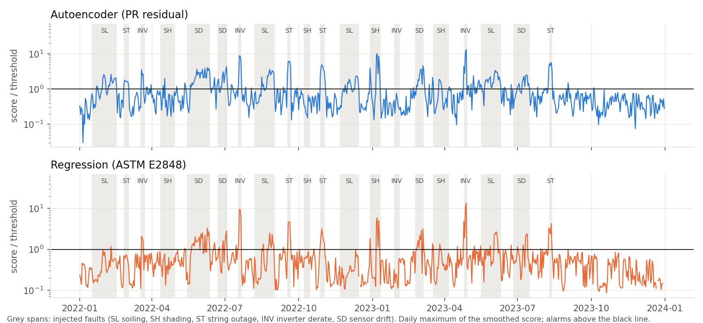
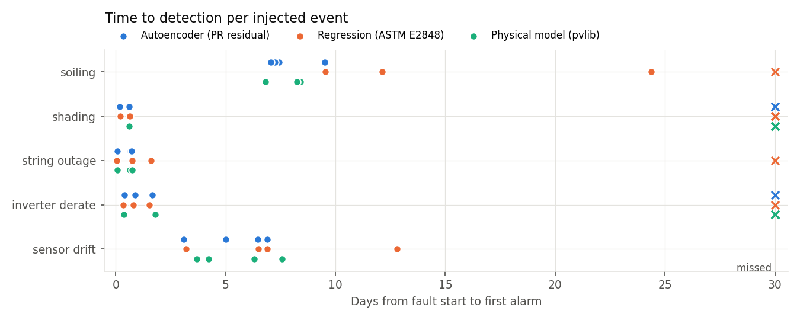

# Finding faults in a PV plant: autoencoder vs. simple baselines


Can a small neural network find faults in a solar plant's SCADA data better than the methods performance engineers
already use? This project compares a **dense PyTorch autoencoder** with three standard baselines (a performance-ratio
threshold, an ASTM E2848-style regression and a pvlib physical model) on **simulated 15-minute data with injected,
labelled faults**: soiling, shading, string outages, inverter derating and irradiance-sensor drift. Because the faults
are known exactly, every method can be scored per fault type, including how long it takes to raise the first alarm.

## Key results

Test period: two years of a synthetic 1 MWp plant (seed 42) with 20 injected faults (4 per type). Every method has its
threshold set to the same false-alarm budget on healthy validation days. Pooled over all fault types:

| Method | Precision | Recall | F1 | Avg. precision | Events detected | False alarms / 30 healthy days |
|---|---|---|---|---|---|---|
| **Autoencoder, PR residual** | 0.94 | **0.65** | **0.77** | **0.89** | **17 / 20** | 3.0 |
| Regression (ASTM E2848) | 0.98 | 0.23 | 0.37 | 0.77 | 15 / 20 | 0.9 |
| Physical model (pvlib) | 0.97 | 0.32 | 0.48 | 0.64 | 15 / 20 | 1.2 |
| PR threshold | 0.91 | 0.33 | 0.48 | 0.70 | 15 / 20 | 5.0 |
| Autoencoder, MSE (textbook score) | 0.91 | 0.16 | 0.28 | 0.58 | 15 / 20 | 1.1 |

The ranking holds on five other simulated plants (new weather, faults, split and network seed each time):

| Method | F1, mean ± sd | Avg. precision | False alarms / 30 days |
|---|---|---|---|
| **Autoencoder, PR residual** | **0.68 ± 0.07** | **0.89 ± 0.02** | 1.0 ± 0.3 |
| Regression (ASTM E2848) | 0.42 ± 0.11 | 0.72 ± 0.06 | 2.6 ± 0.5 |
| Physical model (pvlib) | 0.36 ± 0.08 | 0.54 ± 0.04 | 1.5 ± 0.6 |
| PR threshold | 0.31 ± 0.03 | 0.57 ± 0.05 | 2.2 ± 0.3 |
| Autoencoder, MSE | 0.21 ± 0.10 | 0.58 ± 0.06 | 1.2 ± 0.6 |

- **The autoencoder flags faulty periods far more completely**: recall 0.65 vs. at most 0.33 at similar precision.
  Event-level detection is closer: 73 of 100 events across the five seeds vs. 69-70 for the baselines.
- **It wins on slow faults**: soiling and sensor drift are caught at a median loss of **3.3 %** (labels start at
  3 %), against 5.4 % (soiling) and 4.6 % (drift) for the regression. Soiling is flagged after a median 7 days
  against 12.
- **It is worse on inverter derating** (F1 0.42 vs. 0.84 for the regression). A healthy plant with a DC/AC ratio of
  1.25 clips at 800 kW on bright days, the network has learned that a flat top is normal and partly accepts a lower
  flat top too. **Shading is hard for every method**: it affects a few low-sun hours, mostly in winter.
- **How the reconstruction error is scored matters more than the network.** The textbook score, mean squared error
  over all inputs, is the worst method here: squared errors are dominated by cloud noise, and a steady 10 % power
  loss barely moves them. The signed residual of one channel, the performance ratio, averaged over time, lets a
  consistent shortfall accumulate while noise cancels. That one change lifts average precision from 0.58 to 0.89.
- **False alarms come from broken clouds**: 43 of the autoencoder's 45 false alarms on the test plant fall on
  broken-cloud days, when the single pyranometer and the 1 MWp array see different clouds.





### What the faults and alarms look like

The last days of one event per type. Grey: what the healthy plant would have produced (ground truth), blue: the
measurement, red: autoencoder alarms. In the soiling and derate panels the alarms stop once the fault is fixed.



The score of the two best methods over the whole test period, relative to its threshold, with the faults shaded:





## Data: a simulated plant with known faults

Public PV datasets rarely say *when* something was wrong, and without that ground truth precision and recall cannot
be measured. The plant is therefore simulated with [pvlib](https://pvlib-python.readthedocs.io) and faults are injected
with known start, end and severity. Nothing is downloaded; a full simulation takes about 3 seconds.

**Plant.** 1 MWp DC on an 800 kW inverter (DC/AC 1.25), 16 strings, fixed tilt 30° facing south, at 52.2° N 21.0° E
(central Poland). Three years at 15-minute resolution: 2021 is healthy and used for training, 2022-2023 are the test
period with faults. The calendar years are labels only; the weather is synthetic.

**Weather.** pvlib clear sky (Ineichen with the bundled Linke turbidity climatology), times a clear-sky index from a
stochastic model: each day gets a sky regime (clear, broken clouds, overcast) from a Markov chain with seasonal
probabilities, and the index follows an AR(1) process within the day. Erbs decomposition and isotropic transposition
give plane-of-array irradiance. Ambient temperature and wind follow seasonal and diurnal cycles with slow random
anomalies; module temperature follows the SAPM model.

**Physics the detectors do not get.** The simulator uses incidence-angle losses (physical IAM), the ADR efficiency
model (low-light and temperature effects), a hidden 3 % DC loss and a PVWatts inverter efficiency curve with
clipping. The detectors only see what a SCADA system records: **AC power, plane-of-array irradiance, module and
ambient temperature, wind speed**, with sensor noise. The pyranometer's noise is 1 % on stable days and 5 % under
broken clouds, because a point sensor and a large array do not see the same clouds.

**Faults** (one at a time, 5-25 healthy days between them):

| Type | Mechanism | Duration | Severity |
|---|---|---|---|
| Soiling | DC loss growing linearly from 0, removed by cleaning at the end | 15-35 days | final loss 4-15 % |
| Shading | new obstruction south-east or south-west blocks part of the beam when the sun is behind it and low | 7-21 days | 40-80 % of beam |
| String outage | 1-3 of 16 strings disconnected | 2-8 days | 6-19 % of DC |
| Inverter derate | AC output capped below the rating (overheating, wrong set-point) | 3-10 days | cap at 55-80 % |
| Sensor drift | pyranometer reading drifts linearly up or down; the plant itself is healthy | 10-30 days | ±6-15 % at the end |

**Labels.** A daylight 15-minute step (sun at least 10° above the horizon) is a positive when a fault is active and
changes the power, or the irradiance reading, by at least 3 %. Steps where a fault is active but has a smaller effect,
such as the first days of soiling or a derated inverter on a cloudy day, are left out of the point metrics rather
than counted as healthy.

## Method

**Features** per step: AC power / rating, **performance ratio** (AC power / (DC nameplate × POA / 1000), i.e. power
normalised to irradiance), POA, clear-sky index (POA / clear-sky POA, which exposes a drifting sensor on clear days),
module and ambient temperature, and the sun's elevation and azimuth (time of day and season).

**Baselines**, each fitted on the healthy training days only:

- *PR threshold*: the performance ratio against its training median.
- *Regression (ASTM E2848)*: `P = POA · (a1 + a2·POA + a3·T_amb + a4·wind)` by least squares on non-clipping points,
  capped at the inverter rating.
- *Physical model (pvlib)*: PVWatts DC model from nameplate data and a datasheet temperature coefficient, PVWatts
  inverter, and one scale factor fitted on the training data, as an analyst would calibrate an expected-yield model.

Each produces a signed residual (measured minus expected) divided by its robust training spread (1.4826 · MAD).

**Autoencoder.** Inputs are windows of 8 consecutive steps (2 hours) of all 9 features, standardised and flattened
(72 values). Dense encoder 72 → 64 → 32 → **6** and a mirrored decoder, ReLU, MSE loss, Adam (lr 1e-3, weight decay
1e-5), batch 256, 100 epochs with early stopping on validation days. Training takes about 25 seconds on a laptop CPU.
The network only ever sees healthy data, so through the narrow bottleneck it learns how power, irradiance, temperature
and sun position normally go together, and its reconstruction of a faulty window is pulled back towards healthy
behaviour. Two scores are compared:

- **PR residual**: measured minus reconstructed performance ratio, averaged over the window, in training-spread units.
- **MSE**: mean squared reconstruction error over all 72 values, the usual textbook choice.

**From score to alarm**, identical for every method: average the score over the last 8 daylight steps (absolute value
of the mean for signed residuals, so consistent offsets accumulate and noise cancels), then raise an alarm above the
**99.5th percentile of the same score on validation days**. Validation is 20 % of the healthy year's days, held out from
training, so all methods get the same false-alarm budget without seeing a single fault.

**Metrics.** Point-wise precision, recall and F1 on the test period, pooled and per fault type. Per-type precision
uses the healthy steps plus the steps of that type, so all types share the same false positives. Average precision is
the area under the precision-recall curve of the smoothed score, threshold-free. An event counts as detected when an
alarm fires while the fault has a labelled effect; time to detection runs from the event's start. False alarms are
alarm episodes (runs of alarmed steps) that start while no fault is active.

**No tuning on the test plant.** Design choices were made on separate development simulations (seeds 7 and 8): the
PR-residual score, bottleneck size 6 (12 or 16 let the network reconstruct the faults too: average precision fell from
0.89 to 0.75 and 0.67), the window of 8 steps, a nominal PR in place of zeros below 50 W/m² (zeros dominated the
feature's spread), and each baseline's residual unit (the regression works better in kW per kWp, the physical model in
PR units). Seed 42 and the sweep seeds 1-5 were run once with those settings.

## Limitations

- **Simulated data.** The network learns the simulator's physics, and the faults are clean, one at a time and
  idealised. Real plants add data gaps, curtailment, snow, degradation, grid outages, overlapping faults and much
  messier sensors. The results rank methods under controlled conditions; they are not field accuracy.
- **Faults are frequent**: about 40 % of the evaluated test steps are positive, far more than in a real fleet, so
  precision is optimistic. False alarms per 30 healthy days is the more transferable number.
- **Plant-level signals only.** Inverter- or string-level data would make string outages and derating much easier to
  see. A real deployment would also compare neighbouring inverters.
- **Clean training year assumed.** Training on data that already contains faults is not tested.
- **A dense window autoencoder is the simplest choice.** LSTM or convolutional autoencoders, and training with
  contaminated data, are natural next steps.
- Everything is one plant design at one location.

## Run it

```bash
pip install -e ".[dev]"     # on CI: pip install torch --index-url https://download.pytorch.org/whl/cpu first
pytest -q
python -m pv_anomaly run
```

`run` simulates the plant, fits the baselines, trains the autoencoder, calibrates thresholds and writes `results/`
(per-type and per-event metrics, false alarms, training history, `run.json`), the charts in `docs/img/` and the
trained network in `models/autoencoder.pt`. The whole run takes about 40 seconds on a laptop CPU.
`python -m pv_anomaly run --no-train` scores with the saved model, and `python -m pv_anomaly sweep --seeds 1 2 3 4 5`
repeats the experiment on other simulated plants (about 3 minutes). `--help` lists all options (window, bottleneck,
smoothing, threshold quantile, seed). Everything is seeded (`--seed 42` by default) and runs on the CPU.

```
src/pv_anomaly/
  plant.py        plant definition, solar geometry, 'true' physical model
  simulate.py     stochastic weather, fault schedule and injection
  features.py     features, train/validation/test split, sliding windows
  baselines.py    PR threshold, ASTM E2848 regression, pvlib physical model
  autoencoder.py  dense window autoencoder: training, scoring, save/load
  detect.py       smoothing and threshold calibration
  evaluate.py     labels, point/event metrics, time to detection, false alarms
  plots.py        charts
  cli.py          command line interface
tests/            simulator, features, baselines, autoencoder and metric tests (no network access)
```

## License

MIT. Physics by [pvlib](https://github.com/pvlib/pvlib-python) (BSD-3-Clause).
