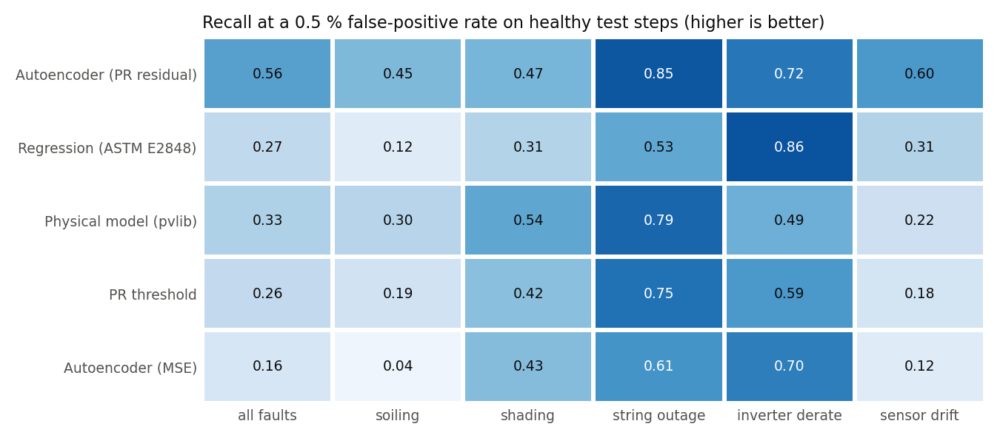
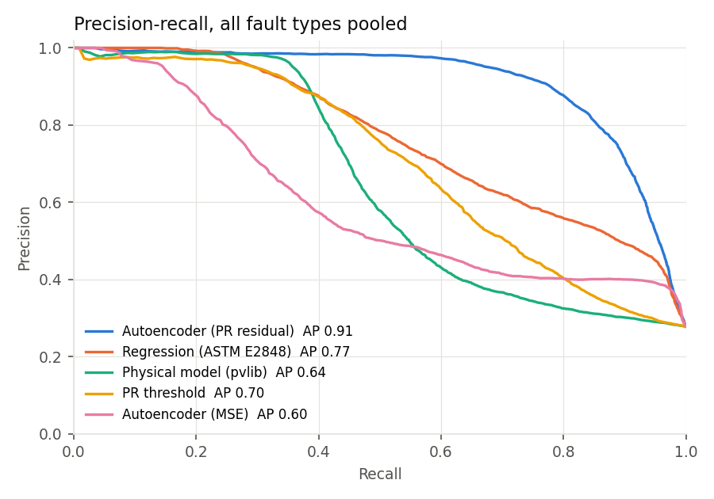
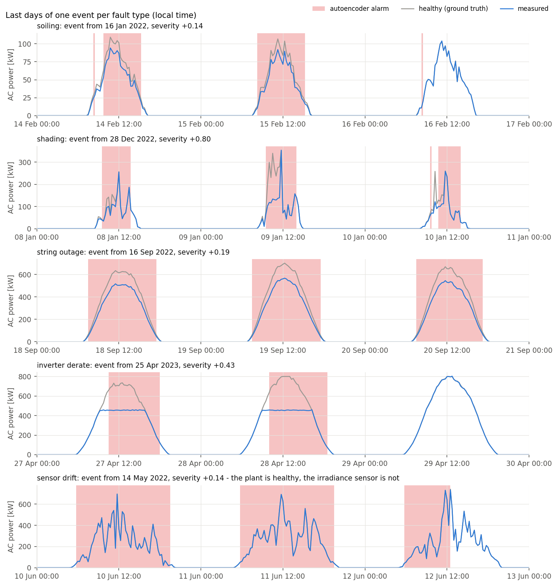
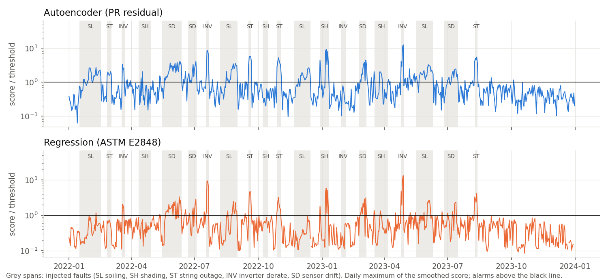
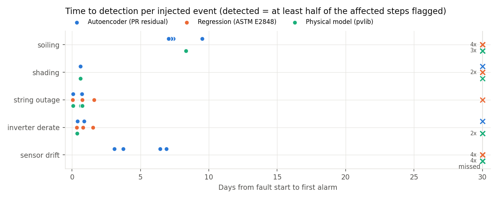
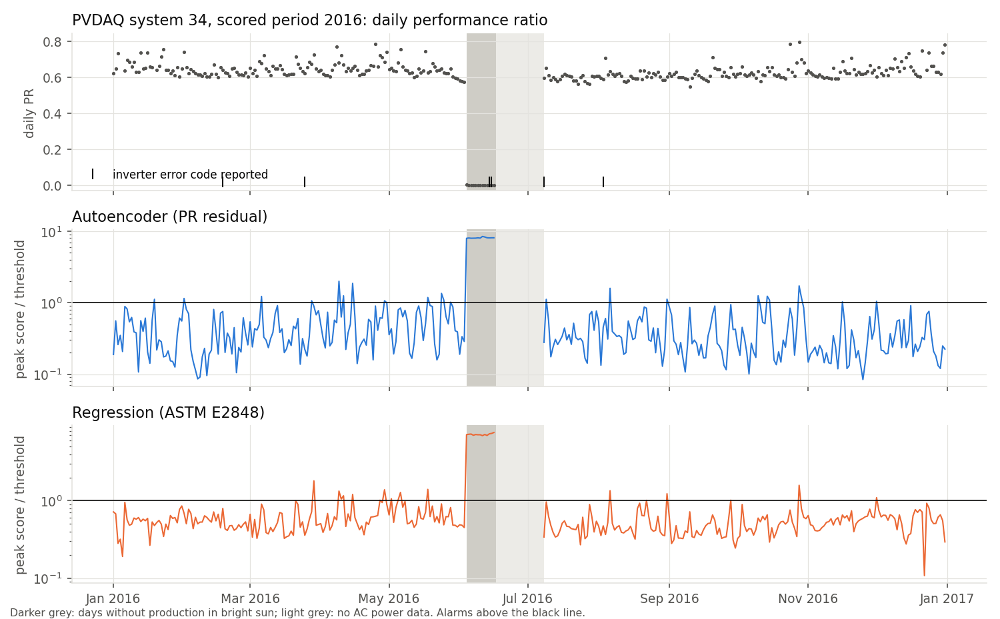
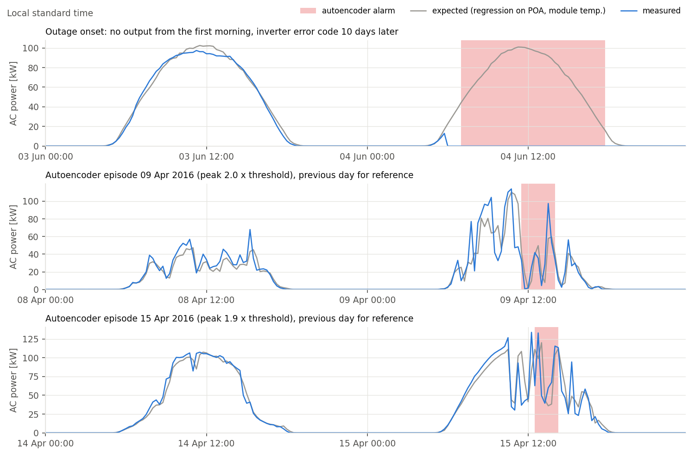

# Finding faults in a PV plant: autoencoder vs. simple baselines


Can a small neural network find faults in a solar plant's SCADA data better than the methods performance engineers
already use? This project compares a **dense PyTorch autoencoder** with three standard baselines (a performance-ratio
threshold, an ASTM E2848-style regression and a pvlib physical model) on **simulated 15-minute data with injected,
labelled faults**: soiling, shading, string outages, inverter derating and irradiance-sensor drift. Because the faults
are known exactly, every method can be scored per fault type, including how long it takes to raise the first alarm.
A second experiment runs the same detectors on **two years of real data** from a public NREL PVDAQ system, where
they catch an inverter outage that the inverter's own error code reported 10 days late.

## Key results

Test period: two years of a synthetic 1 MWp plant (seed 42) with 20 injected faults, 4 per type. Three of them (two
shading events in spring and autumn, one inverter derate in winter) never change the output by 3 % in daylight, so
17 events can be detected at all.

Every threshold is set to a 0.5 % false-positive rate on held-out healthy days. On the test period these rates drift
apart (0.16-1.6 %, second table), so the first table compares the methods without a threshold (average precision) and
at one matched false-positive rate on the healthy test steps:

| Method | Avg. precision | Recall at 0.5 % FPR | Events detected (of 17) | Events detected by chance |
|---|---|---|---|---|
| **Autoencoder, PR residual** | **0.91** | **0.56** | **15** | 1.6 |
| Regression (ASTM E2848) | 0.77 | 0.27 | 6 | 0.1 |
| Physical model (pvlib) | 0.64 | 0.33 | 7 | 0.2 |
| PR threshold | 0.70 | 0.26 | 7 | 0.1 |
| Autoencoder, MSE (textbook score) | 0.60 | 0.16 | 5 | 0.1 |

An event counts as detected when at least half of its affected daylight steps raise an alarm. "By chance" is the same
count after shifting each method's alarms by whole days (12 shifts between 29 and 643 days), which keeps their daily
and seasonal pattern but breaks their link to the faults. A looser rule, one alarm anywhere in the affected part of an
event, credits every method with 15-17 events, but shifted alarms already reach 6.5-9.7 of them on average and up to
13 (`results/chance.csv`), so it says little.

The operating point that the calibrated threshold actually gives on the test period:

| Method | Precision | Recall | F1 | FPR on healthy test steps | False alarms / 30 healthy days |
|---|---|---|---|---|---|
| Autoencoder, PR residual | 0.94 | 0.69 | 0.80 | 1.6 % | 3.0 |
| Regression (ASTM E2848) | 0.98 | 0.23 | 0.37 | 0.16 % | 0.9 |
| Physical model (pvlib) | 0.97 | 0.32 | 0.48 | 0.38 % | 1.2 |
| PR threshold | 0.91 | 0.33 | 0.48 | 1.3 % | 5.0 |
| Autoencoder, MSE | 0.91 | 0.18 | 0.29 | 0.67 % | 1.1 |

On five other simulated plants (new weather, faults, split and network seed each time) the ranking holds, but seed 42
is a favourable draw for the autoencoder's event count. On all six seeds (42 and 1-5) the PR-residual autoencoder has
the highest average precision, recall at the matched rate, F1 and number of detected events; with six seeds that is a
consistent pattern, not a significance test. Mean ± standard deviation over seeds 1-5 (`results/sweep_seeds.csv`):

| Method | Avg. precision | Recall at 0.5 % FPR | Events detected (of 81) | by chance | FPR on healthy test steps | False alarms / 30 days |
|---|---|---|---|---|---|---|
| **Autoencoder, PR residual** | **0.90 ± 0.02** | **0.49 ± 0.07** | **37** | 4.67 | 0.6 ± 0.2 % | 0.9 ± 0.4 |
| Regression (ASTM E2848) | 0.72 ± 0.06 | 0.26 ± 0.08 | 18 | 2.25 | 0.6 ± 0.1 % | 2.6 ± 0.5 |
| Physical model (pvlib) | 0.54 ± 0.04 | 0.23 ± 0.06 | 12 | 1.00 | 0.5 ± 0.2 % | 1.5 ± 0.6 |
| PR threshold | 0.57 ± 0.05 | 0.18 ± 0.02 | 8 | 0.58 | 0.6 ± 0.2 % | 2.2 ± 0.3 |
| Autoencoder, MSE | 0.58 ± 0.06 | 0.11 ± 0.04 | 10 | 1.00 | 0.7 ± 0.4 % | 1.3 ± 0.6 |

Events are summed over the five seeds (5-9 detected per seed for the autoencoder). On these seeds the autoencoder's
test false-positive rate is in line with the other methods, so the 1.6 % on seed 42 belongs to that seed's draw. The
baselines' order changes with the seed and the metric.

- **The autoencoder flags faulty periods more completely at the same false-positive rate**: recall 0.56 against at
  most 0.33 for the baselines when every method flags 0.5 % of the healthy test steps. Its higher recall at the
  calibrated threshold (0.69) is partly bought with a test false-positive rate of 1.6 %, three times its calibration
  rate.
- **It wins on slow faults**: it detects all four soiling and all four sensor-drift events (at least half of their
  affected steps flagged); the regression and the PR threshold detect none of them, the physical model one soiling
  event. Its first
  alarm on these events comes at a median loss of 3 %, which is where the labels start, so the labelling and not the
  detector sets that floor. Soiling is flagged a median 7 days after it starts.
- **Inverter derating and shading are small classes**, so their numbers rest on few events: at the matched rate the
  regression catches more derating (recall 0.86 against 0.72) and the physical model more shading (0.54 against
  0.47). Per-type F1 at the calibrated threshold is not shown: on classes this small it mostly reflects each method's
  test false-positive rate.
- **Part of the lead over the baselines is integration time.** The autoencoder scores a 2-hour window and is then
  smoothed like the baselines, so its score covers about twice as many steps. At equal integration the average
  precision of autoencoder and regression is 0.88 against 0.77 (8 steps) and 0.91 against 0.83 (15-16 steps): the
  lead shrinks from 0.15 with the default settings to 0.12 and 0.08, but does not disappear
  (`results/integration.csv`).
- **With the same network and the same integration, the score decides**: the textbook mean squared error over all
  inputs reaches an average precision of 0.60, the signed residual of the performance-ratio channel 0.91. Squared
  errors are dominated by cloud noise and a steady 10 % power loss barely moves them; a signed mean lets a consistent
  shortfall accumulate while noise cancels.
- **False alarms come from broken clouds**: 45 of the autoencoder's 46 false-alarm episodes on the test plant
  start on broken-cloud days, when the single pyranometer and the 1 MWp array see different clouds.





### What the faults and alarms look like

The last days of one event per type. Grey: what the healthy plant would have produced (ground truth), blue: the
measurement, red: autoencoder alarms. In the soiling and derate panels the alarms stop shortly after the fault is
fixed (the score still covers the last hours of the fault).



The score of the two best methods over the whole test period, relative to its threshold, with the faults shaded:





## Real data: NREL PVDAQ system 34

The same detectors on a real rooftop system: [PVDAQ](https://doi.org/10.25984/1846021) system 34 in Las Vegas, NV
(146.6 kWp, 611 mono-Si modules at 11.2° facing south, one 135 kW central inverter), 15-minute data for 2016-2017.
`python -m pv_anomaly real` downloads the 731 daily files (8 MB) from the public OEDI bucket.

**What the data contain.** On **4 June 2016 at 06:00** (local standard time) the inverter stopped producing while
its status code still read 0. The first error code arrived on 14 June, **10 days later**. The logger recorded zero
output until 16 June; then the inverter channels go missing until output returns on 8 July, 34 days after the stop
(the course of this outage and the site's timestamp conventions are in the shared
[PVDAQ site notes](https://github.com/kwwaleszczynski-del/pv-outage-classifier/blob/main/PVDAQ_SITE_NOTES.md)).
Detection times below count from 06:30, the first step above 300 W/m². 2017 has no such days. The site's sensors
have their own problems: the ambient temperature sensor reads exactly 0 °F for most winter hours, and the anemometer
is stuck at zero much of the time.

**Setup.** No fault labels exist, so precision and recall cannot be computed. Instead, the detectors learn normal
behaviour from the healthy year 2017 (the same 70 / 10 / 20 % split of its days for training, early stopping and
threshold calibration) and score 2016, which contains the outage. The direction of time does not matter for this
purpose: only one healthy year of the same plant is needed. Because of the broken sensors, the autoencoder drops the
ambient temperature feature and the regression uses module temperature without a wind term. Everything else is
unchanged from the synthetic experiment: architecture, smoothing and the 99.5 % calibration quantile.

| | Time to flag the outage | Alarm episodes outside the outage (2016) |
|---|---|---|
| **Autoencoder, PR residual** | 0.5 h | 22 |
| Regression (module temperature) | 0.25 h | 29 |
| Physical model (pvlib) | 0 h | 19 |
| Inverter error code | **241 h (10 days)** | - |

- **What this shows is narrow: one event, defined from the data.** A zero-output outage in full sun is flagged within
  30 minutes of its first bright step by every detector, while the inverter's error code came 10 days later. Any model
  that compares power with irradiance would do this; it says nothing about subtle faults.
- **The other alarm episodes cannot be verified.** Without maintenance logs there is no way to tell whether any of
  them was a real, small fault. The autoencoder's two strongest ones fall on broken-cloud days (below), the same
  situation that causes false alarms in the simulation.





## Data: a simulated plant with known faults

Public PV datasets rarely say *when* something was wrong, and without that ground truth precision and recall cannot
be measured. The plant is therefore simulated with [pvlib](https://pvlib-python.readthedocs.io) and faults are injected
with known start, end and severity. Nothing is downloaded; a full simulation takes about 3 seconds.

**Plant.** 1 MWp DC on an 800 kW inverter (DC/AC 1.25), 16 strings, fixed tilt 30° facing south, at 52.2° N 21.0° E
(central Poland). Three years at 15-minute resolution: 2021 is healthy and used for training, 2022-2023 are the test
period with faults. The calendar years are labels only; the weather is synthetic.

**Weather.** pvlib clear sky (Ineichen with the bundled Linke turbidity climatology), times a clear-sky index from a
stochastic model: each day gets a sky regime (clear, broken clouds, overcast) from a Markov chain with seasonal
probabilities, and the index follows an AR(1) process within the day. Erbs decomposition and isotropic transposition
give plane-of-array irradiance. Ambient temperature and wind follow seasonal and diurnal cycles with slow random
anomalies; module temperature follows the SAPM model.

**Physics the detectors do not get.** The simulator uses incidence-angle losses (physical IAM), the ADR efficiency
model (low-light and temperature effects), a hidden 3 % DC loss and a PVWatts inverter efficiency curve with
clipping. The detectors only see what a SCADA system records: **AC power, plane-of-array irradiance, module and
ambient temperature, wind speed**, with sensor noise. The pyranometer's noise is 1 % on stable days and 5 % under
broken clouds, because a point sensor and a large array do not see the same clouds.

**Faults** (one at a time, 5-25 healthy days between them):

| Type | Mechanism | Duration | Severity |
|---|---|---|---|
| Soiling | DC loss growing linearly from 0, removed by cleaning at the end | 15-35 days | final loss 4-15 % |
| Shading | new obstruction south-east or south-west blocks part of the beam when the sun is behind it and low | 7-21 days | 40-80 % of beam |
| String outage | 1-3 of 16 strings disconnected | 2-8 days | 6-19 % of DC |
| Inverter derate | AC output capped below the rating (overheating, wrong set-point) | 3-10 days | cap at 55-80 % |
| Sensor drift | pyranometer reading drifts linearly up or down; the plant itself is healthy | 10-30 days | ±6-15 % at the end |

**Labels.** A daylight 15-minute step (sun at least 10° above the horizon) is a positive when a fault is active and
changes the power, or the irradiance reading, by at least 3 %. Steps where a fault is active but has a smaller effect,
such as the first days of soiling or a derated inverter on a cloudy day, are left out of the point metrics rather
than counted as healthy.

## Method

**Features** per step: AC power / rating, **performance ratio** (AC power / (DC nameplate × POA / 1000), i.e. power
normalised to irradiance), POA, clear-sky index (POA / clear-sky POA, which exposes a drifting sensor on clear days),
module and ambient temperature, and the sun's elevation and azimuth (time of day and season).

**Baselines**, each fitted on the healthy training days only:

- *PR threshold*: the performance ratio against its training median.
- *Regression (ASTM E2848)*: `P = POA · (a1 + a2·POA + a3·T_amb + a4·wind)` by least squares on non-clipping points,
  capped at the inverter rating.
- *Physical model (pvlib)*: PVWatts DC model from nameplate data and a datasheet temperature coefficient, PVWatts
  inverter, and one scale factor fitted on the training data, as an analyst would calibrate an expected-yield model.

Each produces a signed residual (measured minus expected) divided by its robust training spread (1.4826 · MAD).

**Autoencoder.** Inputs are windows of 8 consecutive steps (2 hours) of all 9 features, standardised and flattened
(72 values). Dense encoder 72 → 64 → 32 → **6** and a mirrored decoder, ReLU, MSE loss, Adam (lr 1e-3, weight decay
1e-5), batch 256, up to 100 epochs, keeping the weights with the lowest loss on separate early-stopping days. Training
takes about 30 seconds on a laptop CPU.
The network only ever sees healthy data, so through the narrow bottleneck it learns how power, irradiance, temperature
and sun position normally go together, and its reconstruction of a faulty window is pulled back towards healthy
behaviour. Two scores are compared:

- **PR residual**: measured minus reconstructed performance ratio, averaged over the window, in training-spread units.
- **MSE**: mean squared reconstruction error over all 72 values, the usual textbook choice.

**From score to alarm**, identical for every method: average the score over the last 8 daylight steps (absolute value
of the mean for signed residuals, so consistent offsets accumulate and noise cancels), then raise an alarm above the
**99.5th percentile of the same score on calibration days**. The healthy year is split by whole days: 70 % train the
models, 10 % only decide when the autoencoder stops training (the baselines, which need no stopping rule, are fitted on
them too), and 20 % calibrate the thresholds and are never seen by any model. Every method therefore flags 0.5 % of
the calibration steps without seeing a single fault. On the test period that rate is not kept (0.16-1.6 % on seed 42):
a quantile estimated from about 2,900 calibration steps is noisy, and the test years have different weather. Moving
the autoencoder's early stopping off the calibration days did not change this. That is why the comparison also uses
recall at a false-positive rate matched on the healthy test steps.

**Metrics.** Average precision is the area under the precision-recall curve of the smoothed score, threshold-free.
Recall at a matched rate uses, for every method, the threshold that flags 0.5 % of the healthy test steps. Point-wise
precision, recall and F1 at the calibrated threshold describe the operating point. Per-type metrics use the healthy
steps plus the steps of that type; inverter derating (148 affected steps in three events) and shading (106 steps, 97 of
them in one event) are small classes, so their per-type numbers rest on few events. An event counts as detected when
at least half of its affected daylight steps raise an alarm, and the chance level of that count comes from alarms
shifted by whole days. Time to detection runs from the event's start to the first alarmed affected step of a detected
event. False alarms are alarm episodes (runs of alarmed steps) that start while no fault is active.

**No tuning on the test plant.** Design choices were made on separate development simulations (seeds 7 and 8): the
PR-residual score, bottleneck size 6 (12 or 16 let the network reconstruct the faults too: average precision fell from
0.89 to 0.75 and 0.67), the window of 8 steps, a nominal PR in place of zeros below 50 W/m² (zeros dominated the
feature's spread), and each baseline's residual unit (the regression works better in kW per kWp, the physical model in
PR units). Seed 42 and the sweep seeds 1-5 were run once with those settings.

## Limitations

- **Simulated data.** The network learns the simulator's physics, and the faults are clean, one at a time and
  idealised. Real plants add data gaps, curtailment, snow, degradation, grid outages, overlapping faults and much
  messier sensors. The results rank methods under controlled conditions; they are not field accuracy.
- **Faults are frequent**: 28 % of the evaluated test steps are positive (6,497 of 23,271), far more than in a real
  fleet, so precision is optimistic. False alarms per 30 healthy days is the more transferable number.
- **The clear-sky index comes from the simulator's own clear-sky model**, which a real plant could only approximate.
  Without it (`python -m pv_anomaly ablation`, `results/ablation_kc.csv`) the autoencoder's average precision drops
  only from 0.91 to 0.88, still above every baseline, but its recall at the matched rate falls from 0.56 to 0.45 and
  its detected events from 15 to 8 of 17, so much of the event-level lead on seed 42 depends on this feature.
- **Plant-level signals only.** Inverter- or string-level data would make string outages and derating much easier to
  see. A real deployment would also compare neighbouring inverters.
- **Clean training year assumed.** Training on data that already contains faults is not tested.
- **A dense window autoencoder is the simplest choice.** LSTM or convolutional autoencoders, and training with
  contaminated data, are natural next steps.
- Everything simulated is one plant design at one location; the real-data check is one small rooftop system
  without fault labels.

## Run it

```bash
pip install -e ".[dev]"     # on CI: pip install torch --index-url https://download.pytorch.org/whl/cpu first
pytest -q
python -m pv_anomaly run
```

`run` simulates the plant, fits the baselines, trains the autoencoder, calibrates thresholds and writes `results/`
(per-type and per-event metrics, false alarms, training history, `run.json`), the charts in `docs/img/` and the
trained network in `models/autoencoder.pt`. The whole run takes about 40 seconds on a laptop CPU.
`python -m pv_anomaly run --no-train` scores with the saved model, and `python -m pv_anomaly sweep --seeds 1 2 3 4 5`
repeats the experiment on other simulated plants (a few minutes), `python -m pv_anomaly ablation` retrains the
autoencoder without the clear-sky index, and `python -m pv_anomaly real` downloads PVDAQ
system 34 (8 MB, cached in `data/pvdaq/`, not part of the repository) and writes `results/pvdaq_34/` and its charts
in about two minutes on the first run, download included. `--help` lists all options (window, bottleneck,
smoothing, threshold quantile, seed, periods).
Everything is seeded (`--seed 42` by default) and runs on the CPU.

```
src/pv_anomaly/
  plant.py        plant definition, solar geometry, 'true' physical model
  simulate.py     stochastic weather, fault schedule and injection
  features.py     features, train / early-stopping / calibration / test split, sliding windows
  baselines.py    PR threshold, ASTM E2848 regression, pvlib physical model
  autoencoder.py  dense window autoencoder: training, scoring, save/load
  detect.py       smoothing and threshold calibration
  evaluate.py     labels, point/event metrics, chance level, matched-rate recall, false alarms
  pvdaq.py        NREL PVDAQ download and loader (units, time zone, sensor dropouts)
  plots.py        charts
  cli.py          command line interface
tests/            simulator, features, baselines, autoencoder, metric and loader tests (no network access)
```

## License

MIT. Physics by [pvlib](https://github.com/pvlib/pvlib-python) (BSD-3-Clause).

Real data: Deline, C., Perry, K., Deceglie, M., Muller, M., Sekulic, W., & Jordan, D. (2021). *Photovoltaic Data
Acquisition (PVDAQ) Public Datasets* [Data set]. Open Energy Data Initiative (OEDI), National Renewable Energy
Laboratory. https://doi.org/10.25984/1846021, licensed under
[CC BY 4.0](https://creativecommons.org/licenses/by/4.0/). The raw files are downloaded on demand and not included
here; `results/pvdaq_34/` holds daily aggregates and alarm episodes derived from them.
